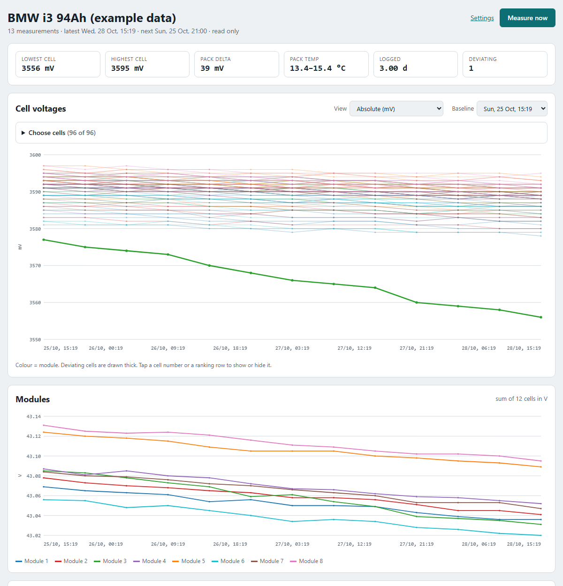

# CellDrift

**Find the battery cell that drifts away from its neighbours.**

CellDrift logs every cell voltage of an EV battery pack through the [Battery Emulator](https://github.com/dalathegreat/Battery-Emulator) at a fixed interval. It then shows which cells lose voltage faster than the rest of their module. That is the classic sign of a cell with high self-discharge, the kind of fault that comes back a few weeks after you balanced the pack.



<sub>Screenshot with example data: one cell in module 3 drops about 7 mV per day while its neighbours stay flat.</sub>

## Why

A pack can look fine right after balancing and still have one leaky cell. You only find it by measuring every cell again after a few days of rest, and comparing each cell with its neighbours rather than with a fixed number. CellDrift does that for you, unattended. It can power the emulator on only for the measurement, so the electronics don't drain the pack in between.

## Features

- **Works with any pack the Battery Emulator shows on its *cellmonitor* page**, for example a BMW i3, Nissan Leaf or Tesla. Cell count, cells per module and the valid voltage range are configurable, so NMC and LFP both work.
- **Unattended logging** at a fixed interval, every full hour by default.
- **Optional Home Assistant switching:** it turns a smart plug or relay on before each measurement, waits until all cells are reported and stable, then turns it off again, also when the measurement failed.
- **Dashboard:**
  - cell voltages with a cell picker per module;
  - module voltages;
  - pack temperature;
  - a balancing warning;
  - a self-discharge ranking (mV/day compared with the module median);
  - a CSV export.
- **Settings in the browser:** emulator address, battery number, cell layout, interval, Home Assistant, password and clearing the data (with an automatic backup).
- **Safe to open from the internet:**
  - HTTPS with a self-signed certificate that also works on iPhones;
  - an optional password (PBKDF2-hashed), login rate limiting and CSRF protection;
  - without a password, everyone can view but only the local network can control it.
- **Phone-friendly** layout, including foldables.
- **One Python file, standard library only.** Python 3.8+ and SQLite, nothing to `pip install`.

## Quick start

```bash
git clone https://github.com/<you>/celldrift.git
cd celldrift
chmod +x start.sh stop.sh make_cert.sh
./make_cert.sh          # optional: HTTPS certificate (needs openssl)
./start.sh              # runs in a screen session "celldrift" (falls back to nohup)
```

Open `https://<ip-of-this-machine>:8100/`, accept the certificate warning once, and go to **Settings**:

| Setting | Example | Notes |
|---|---|---|
| Battery Emulator address | `http://192.168.1.100` | Click **Test emulator**: it reports how many cells it finds. |
| Battery number | `1` | `2` for the second battery of a double-battery setup. |
| Number of cells | `96` | `0` = automatic. A measurement only counts when exactly this many cells are reported. |
| Cells per module | `12` | `0` = no modules; the ranking then compares with the whole pack. |
| Valid cell voltage | `2500`–`4300` mV | NMC ≈ 2500–4300, LFP ≈ 2000–3700. Readings outside the range count as "not ready". |
| Interval | `60` min | `60` = every full hour. |
| Home Assistant | `https://192.168.1.10:8123`, `switch.battery_emulator`, token | Optional. Create the token under *Profile → Security → Long-lived access tokens*. |

The first start creates `config.json`. Settings are stored there, the token in `ha_token.txt`, and the measurements in `celldrift.db`. All of them are readable only by the owner.

## How a measurement works

1. *(optional)* Switch the Home Assistant entity on.
2. Poll `<emulator>/cellmonitor?battery=<n>&data=1` every 5 s for up to 5 minutes, until all cells are present and inside the valid range.
3. Keep reading for another 30 s so the values can settle, then store them together with the pack min/max temperature from the emulator's status page.
4. *(optional)* Switch the entity off again, also when the measurement failed.

## Reading the results

- Let the pack **rest** (no charging, no load, stable temperature) for a few days.
- The **ranking** compares every cell's voltage loss per day with the median of its own module:
  - **deviating** (red): at least 1 mV/day *and* 3 mV more in total than the module median;
  - **watch** (orange): at least 0.5 mV/day and 2 mV more;
  - no verdict before 12 hours of logging.
- If the first measurement was taken right after charging or balancing, pick a **later baseline**.
- Keep an eye on the **balancing** warning: a pack that balances during the test hides exactly what you are looking for.

## Opening it from the internet

1. Forward TCP port **8100** on your router to the machine running CellDrift.
2. Recreate the certificate with your public IP or DNS name included: `./make_cert.sh --force 203.0.113.7`.
3. In **Settings → Access**, turn on **Require a password**.

Plain `http://` on the same port is redirected to `https://`. After 5 wrong passwords, logins from that address are blocked for 15 minutes. Changing the Home Assistant address requires entering the token again, so a stored token can never be sent to another host.

**Forgot the password?** Stop CellDrift, set `"auth_enabled": false` in `config.json` and start it again.

## Running it permanently

Start automatically after a reboot:

```bash
(crontab -l 2>/dev/null; echo "@reboot sleep 60 && $HOME/celldrift/start.sh >> $HOME/celldrift/logger.log 2>&1") | crontab -
```

| Command | What it does |
|---|---|
| `./start.sh` / `./stop.sh` | Start or stop. `./start.sh --no-initial` waits for the next interval instead of measuring right away. |
| `screen -r celldrift` | Watch the log live (detach with Ctrl+A, D). |
| `python3 celldrift.py --once` | One measurement, then exit. |
| `python3 celldrift.py --config other.json` | A second pack with its own config, database and port. |

## Safety

CellDrift only reads data and switches a plug; it never charges or discharges anything. Working on high-voltage EV batteries is dangerous and in many countries requires certification (in the Netherlands, NEN 9140). You use this software at your own risk.

## Credits

Built for the [Battery Emulator](https://github.com/dalathegreat/Battery-Emulator) project, which does all the hard work of talking to the battery.

## License

[MIT](LICENSE)
